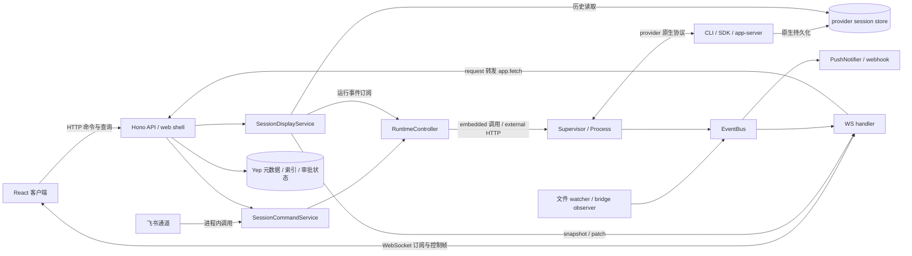

# 现状项目地图

这是一份**源码导航与影响分析地图**。Yep Anywhere 的核心循环是：发现已有项目与会话 → 创建或继续 agent 工作 → 合并历史与运行状态 → 展示输出、处理审批 → 通过收件箱与通知继续监督。主服务既有读取 provider 数据的职责，也有自己的状态存储；不能把它理解为只有一层 CLI 文件浏览器。

## 基线与证据约定

| 项目 | 本次基线 |
| --- | --- |
| 调查日期 | 2026-10-20 修订，Asia/Shanghai。初版为 2026-10-16 |
| Git commit | `635bf0a88e10c90c7554a11cbae700c563b913c7`。上一基线 `934fdbc2f4ce49386e47a5de50dcdc1b8a89579a` |
| commit 时间 | 2026-10-19T17:02:32+08:00 |
| 根版本 | `2026.9.0`，来自根 `package.json`；各 workspace 的 package version 不能替代发行版本 |
| 工作区 | 调查结论对应该 commit 的已跟踪树。调查之后的收口改动记在 [consolidation.md](consolidation.md)，不改写 F1–F5 |
| 调查方式 | 初版为文件读取、全文搜索、Git 查询和文档静态检查。本次用 `git diff 934fdbc2f..635bf0a88` 复核入口变化，并核对设置分类、dsh、本地媒体预览和已删除的设备桥接路径。仍未执行应用测试、构建、网络请求、CLI probe 或浏览器验证 |
| 运行环境 | 调查当时未读取用户会话内容、密钥、个人配置或完整日志，也未确认 8022、4510。用户重启后的 8022 只读核对见 [consolidation.md](consolidation.md#8022-运行核对) |

证据标签贯穿本目录：

- **源码确认**：从入口、注册、调用或具体条件分支确认；文件链接后给出符号或注册表达式。正文未另标注的实现描述均属此类。
- **文档声称**：旧文档、注释或历史验收记录的说法，不能据此认定当前部署或测试通过。
- **已有运行证据**：需要注明环境、时间与证据范围。本次没有独立核验此类证据，不把历史文档的“已验证”升级为本次结论。
- **推断/待确认**：静态调查不足以证明；集中记录在 [findings.md](findings.md)。

适用指令已读取根 [AGENTS.md](../../AGENTS.md)，并遵循本会话提供的上层规则。仓库扫描未发现更深层 `AGENTS.md`。阅读了 [README](../../README.md)、[DEVELOPMENT](../../DEVELOPMENT.md)、[项目总览](../project/project-overview-and-status.md)、[连接矩阵](../project/connection-matrix.md)、[bridge 事件与持久化](../project/bridge-eventing-and-persistence.md)、[hot-apply 与外置 runtime](../project/hot-apply-and-external-runtime.md)；日期计划及审计文档只用作背景，未逐篇验收。

## 先读哪里

| 要解决的问题 | 导航 |
| --- | --- |
| 用户能做什么、由哪些能力协作完成 | [capabilities.md](capabilities.md) |
| 改哪一层、复用哪个入口、有哪些 API | [modules.md](modules.md) |
| 一次操作实际经过哪些步骤，哪里可能失败 | [flows.md](flows.md) |
| 谁写数据、哪个 ID 和状态才对应当前问题 | [data-and-state.md](data-and-state.md) |
| 页面、布局、组件、主题和文案如何组织 | [ui-map.md](ui-map.md) |
| 哪些结论不确定、旧资料哪里可能误导、如何继续核查 | [findings.md](findings.md) |
| 重复实现收到哪了、下一刀做什么 | [consolidation.md](consolidation.md) |

## 当前关系图

图中箭头是**运行时调用、消息或数据读写**，不是 import 图。external 模式下 `Supervisor` 位于独立 runtime 进程；embedded 模式下同处主进程。provider 的原生协议不同，Codex bridge 还可持有外部会话的控制权，图中没有把所有 provider 都画成由 Yep 独占的子进程。

支撑图的接线：

- [packages/server/src/index.ts](../../packages/server/src/index.ts) `startServer`：初始化存储服务、选择 `HttpRuntimeController`、安装 `/api/ws`、启动 Feishu runtime。
- [packages/server/src/app.ts](../../packages/server/src/app.ts) `createApp`：注入 command、interaction、display、scanner、push 和路由。
- [packages/server/src/routes/ws-handlers.ts](../../packages/server/src/routes/ws-handlers.ts) `handleRequest`、`handleSubscribe`：WS 请求复用 Hono，订阅分别交给 runtime、display、activity、focused watcher。
- [packages/client/src/api/client.ts](../../packages/client/src/api/client.ts) `fetchJSON` 与 [packages/client/src/hooks/useConnection.ts](../../packages/client/src/hooks/useConnection.ts) `useConnection`：当前常规 API 使用 HTTP；[packages/client/src/hooks/useSessionStream.ts](../../packages/client/src/hooks/useSessionStream.ts) `useSessionStream` 使用 WS。协议支持 WS request 不代表页面的所有 API 都经过 WS。

**源码导入关系**另看 [modules.md](modules.md)：client 和 server 都导入 shared，provider 原生参考代码不等于生产运行依赖。**共享数据关系**另看 [data-and-state.md](data-and-state.md)：原生会话、Yep JSON 状态、事件 journal、显示缓存不能混为一种存储。

## 应用与启动边界

| 应用/包 | 已确认入口与职责 | 当前启用情况 |
| --- | --- | --- |
| 根 workspace | [package.json](../../package.json) `scripts.dev/start/build:bundle`；[pnpm-workspace.yaml](../../pnpm-workspace.yaml) `packages/*` | 只确认脚本定义，未运行 |
| server | [packages/server/src/index.ts](../../packages/server/src/index.ts) `startServer`；[cli.ts](../../packages/server/src/cli.ts) `runServer`、`runAgentRuntimeOnlyProcess`、`runCodexBridgeOnly` | 主服务、独立 runtime、Codex bridge 均有代码入口，实际形态待确认 |
| client | [packages/client/index.html](../../packages/client/index.html) 加载 `src/main.tsx`；[main.tsx](../../packages/client/src/main.tsx) `createRoot` 与 `Routes` | React/Vite 应用，主服务可托管静态资源或代理 Vite |
| shared | [packages/shared/package.json](../../packages/shared/package.json) `exports`；[src/index.ts](../../packages/shared/src/index.ts) 导出协议、schema、数据模型 | 编译与协议依赖，无独立服务 |
| desktop | [packages/desktop/src-tauri/src/lib.rs](../../packages/desktop/src-tauri/src/lib.rs) `run` 注册 server/installer/pty 命令；[src/App.tsx](../../packages/desktop/src/App.tsx) `App` | 独立 Tauri 管理壳，未验证安装与 sidecar |
| mobile | [packages/mobile/src-tauri/src/lib.rs](../../packages/mobile/src-tauri/src/lib.rs) `run`、`handle_deep_link`；[static-shim/loader.js](../../packages/mobile/static-shim/loader.js) | Tauri + WebView shim，原生构建与通知未验收 |
| dsh 内嵌页 | [packages/client/src/pages/DshPage.tsx](../../packages/client/src/pages/DshPage.tsx) `DshPage`；[packages/server/src/routes/dsh.ts](../../packages/server/src/routes/dsh.ts) `createDshRoutes` | 不是 workspace 包，也不是 provider。按需启动本机 `dsh web` 并代理进 Yep。专题见 [dsh-web.md](../project/dsh-web.md) |
| site | [site/package.json](../../site/package.json) `build`；[site/src/pages/index.astro](../../site/src/pages/index.astro) | 独立 Astro 营销站，非主客户端路由 |
| sharing-worker | [sharing-worker/src/index.ts](../../sharing-worker/src/index.ts) `fetch`：GET 读 R2、Bearer 认证 PUT 写 R2 | 独立 Cloudflare Worker；是否配置待确认 |

端口配置见 [packages/server/src/config.ts](../../packages/server/src/config.ts) `loadConfig`：主端口默认 3400、runtime 默认主端口 +3、runtime 默认 embedded。AGENTS 中的 8022/4510 属于**项目运行约定**。2026-10-20 用户重启后的 8022 核对见 [consolidation.md](consolidation.md#8022-运行核对)；4510 仍未查看。维护服务入口是 [packages/server/src/maintenance/server.ts](../../packages/server/src/maintenance/server.ts) `startMaintenanceServer`，不是 Hono 主 API 的另一组路径。

## 覆盖矩阵

“已盘点”表示核对过入口/注册；“已深入”表示追过至少一条调用及异常分支，不表示逐行审计整个子系统。

| 子系统 | 覆盖状态 | 本次边界 / 仍缺的证据 |
| --- | --- | --- |
| 主启动、配置、API、WS、认证 | 已盘点；核心接线已深入 | 未发请求；反向代理前缀、认证启用状态待确认 |
| command、Supervisor、Process、队列 | 已深入，F1/F3/F4 | 未验证真实进程与所有 provider 模式组合 |
| 历史读取、display、客户端消息流 | 已深入，F2 | Codex 最深入；其他 provider 仅接口/接线及部分 reader，非协议全覆盖 |
| Codex 编辑分叉与 bridge | 已深入，F4；bridge 已盘点 | 参考 schema 和假 app-server 测试已阅读；本机 CLI、4510 未 probe |
| 审批、通知、收件箱、已读 | 已深入，F3/F5 | 无真实推送投递、多设备或重启验收 |
| 元数据、索引、归档、文件快照 | 已盘点；主要读写关系已深入 | 归档恢复、并发文件写入、磁盘故障未动态确认 |
| UI 路由、组件、主题、双语 | 已盘点，主会话接线已深入 | 视觉、触控、焦点、布局、性能待页面验收 |
| Feishu、webhook、账号/网关、分享 | 已盘点 | 未登录、未联网；授权协议及外部服务全链路待确认 |
| 终端、报告、文件浏览、dsh | 已盘点入口 | 未执行 shell、上传、报告写入或 dsh 进程启动。设备串流包与 `/api/devices` 已从树中删除 |
| 桌面壳、移动壳、站点、发布 | 已盘点入口 | Rust 壳内部、构建签名及 CI 成功状态范围外。仓库内已无 Go 或 Android 设备服务包 |
| references、生成协议、历史文档 | 定向抽查 | 不做第三方全库审计；生成文件不逐个分析；不重验历史性能数字 |

## 如何维护

1. 先记录新 commit、工作区差异和验证方式；不要仅更新日期。
2. 从 `main.tsx`、`createApp`、`startServer`、provider registry 和 controller 接口检查入口变化，再更新对应能力/流程。
3. 协议、ID、写入位置变化时同步更新数据页；UI 行为变化时同步更新 UI 页与流程中的可见结果。
4. 保留“测试源码覆盖”与“本次实际执行”的区别；运行证据另附环境、版本、命令与结果摘要，避免贴个人日志。
5. 用 `git diff <旧基线> -- packages scripts .github` 缩小复查范围；按文档链接检查文件，再用 `rg -n '符号名' 路径` 重新定位。符号比固定行号更耐变更。
6. 每次复查至少重做 [findings.md 的两个地图试用](findings.md#地图试用)，未知项只有拿到证据后才改状态。

本地图不是操作授权：发布、服务重启、真实模型请求和浏览器验证都需按当次任务边界执行。
